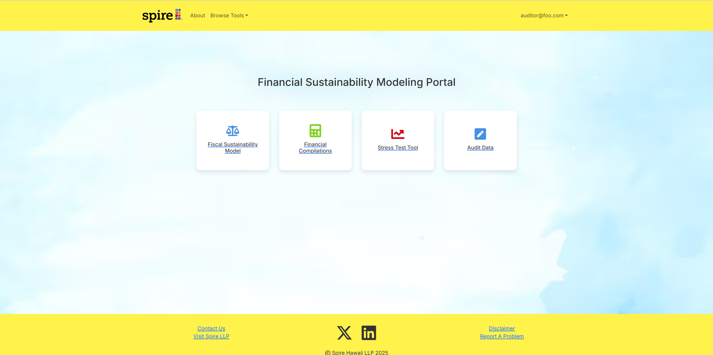
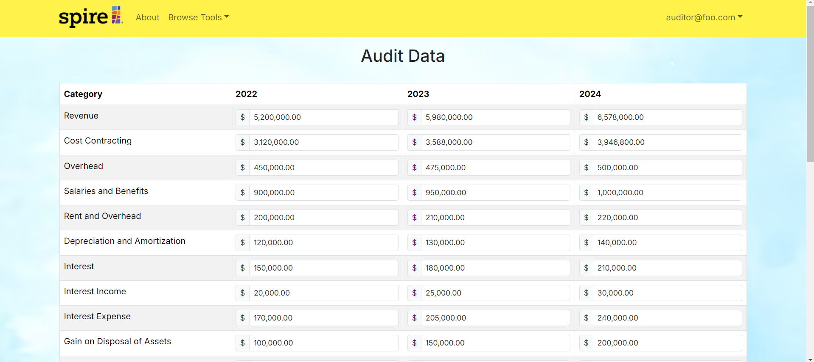

This project involved our team building a financial tool which serves as more comprehensive interface for analysts to represent financial information to clients and run forecast models. We built the tool as a proof of concept for the company Spire Hawaii LLC with input from one of their supervisors. In this project, our team built a web application that would allow auditors to input data securely; analysts then, can run simulations, make future forecasts, or simulate stress tests given drastic financial situations.

Here is a link to the running application: <a href="https://pineapple-spire-lemon.vercel.app/" target="_blank">Pineapple Spire</a>

For more information about the project see our organization GitHub Page: <a href="https://pineapple-spire.github.io/"><i class="large github icon "></i>Pineapple Spire Page</a>

<h2>Leadership</h2>

One role that I stepped into in this project was a communications lead. I quickly noticed in this project that there were many talented developers on the team, however each person often focused mainly on their own tasks. To make sure everyone was on the same page, I took the initiative to schedule regular team meetings. I also made sure to ask design questions so that we all had a better understanding of design choices each engineer was making. Additionally, as I was always keeping up to date on the status of the application, I naturally slipped into a communications lead with the supervisor from Spire Hawaii. Our team had a regular monthly meeting with the client to present the progress we had made. I volunteered to be the primary presenter for these meeting to highlight the key features our app had to offer. I would do the majority of the presenting and sometimes bring in another developer to speak on something they had key insight into.

<h2>Database Design</h2>

Another key role I played in this project was designing the database that was the backbone of storing the financial data for the application. Our team was given a complex spreadsheet to base the app off. I carefully went over the spreadsheet and selected the core fields that would be needed for our database. Additionally, I built a server-side API that calculated fields that were based on database fields. This data provided the basis of all the key financial forecasting tools.

I also built a simple data input form to allow auditors to input and review the database's financial information.

This project shows my technical skills in developing real-world application level software based on communication with a client. It also shows that as I have become more comfortable in software, I have taken initiative to take leadership and keep communication going. I don't just do my GitHub tasks, I keep the team together and on track and am able to communicate with real clients.

Pineapple Spire: <a href="https://pineapple-spire-lemon.vercel.app/" target="_blank">https://pineapple-spire-lemon.vercel.app/</a>

